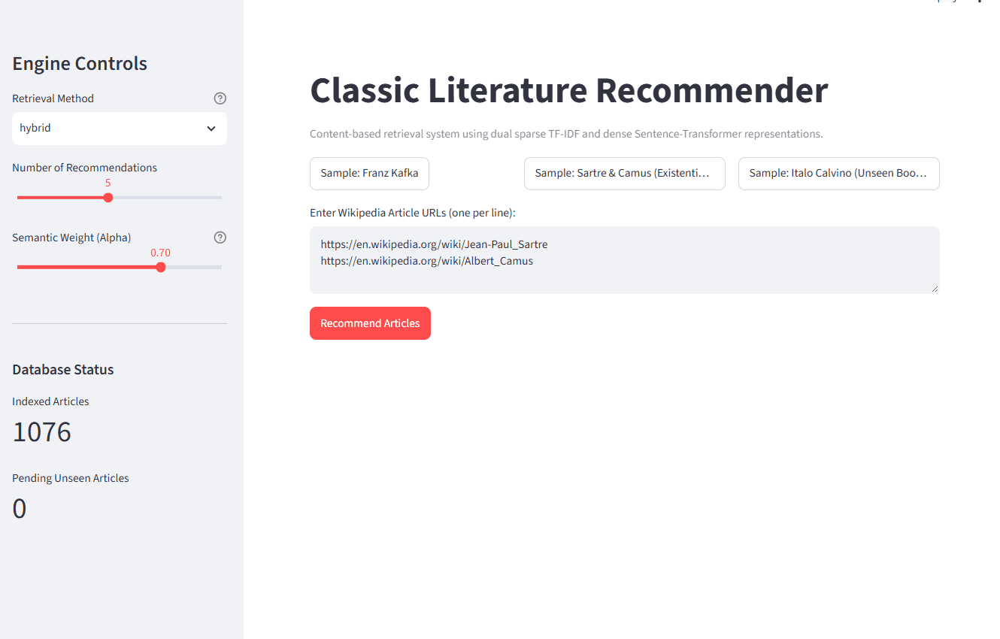

# LiteratureRecommender


An Information Retrieval and Recommendation System that accepts a collection of Wikipedia links (both cached in the database and unseen) and surfaces related classic books and authors with visual prediction breakdowns.



## Highlights

- **Scraping without Topic Drift:** First collecting links from Le Monde's 100 Books of the Century, Nobel Laureates, and Pulitzer Winners. Then extracting 'Notable Works' from authors. Finally scraping all gathered links.
- **Hybrid Scoring Engine:** Blending dense embeddings vectors from (`all-MiniLM-L6-v2`) with sparse lexical matching (TF-IDF over WordNet-lemmatized texts).
- **Dynamic Inference for Unseen URLs:** Paste **any** Wikipedia article link; the engine scrapes, tokenizes, and projects it into the precomputed vector space on the fly.
- **Visual Interpretability:** Word-level contribution attribution charts, score decomposition bars, and multi-source profile influence plots.
- **Self-Expanding Database:** Newly scraped unseen articles can be merged and re-indexed into the Parquet corpus at the click of a button.
- **Decoupled Architecture:** Modular FastAPI backend serving validated Pydantic schemas, consumed by an interactive Streamlit frontend and command-line interface (CLI).

## Mathematical Formulation

### 1. User Profile Centroid
For a user collection of $K$ visited articles $\mathcal{A}_{\text{visited}} = \{a_1, a_2, \dots, a_K\}$:

$$\vec{u}_{\text{dense}} = \frac{1}{K} \sum_{i=1}^K \vec{v}_{a_i}, \quad \hat{u}_{\text{dense}} = \frac{\vec{u}_{\text{dense}}}{\Vert{}\vec{u}_{\text{dense}}\Vert{}_2}$$

$$\vec{u}_{\text{tfidf}} = \frac{1}{K} \sum_{i=1}^K \vec{w}_{a_i}$$

### 2. Candidate Filtering & Similarity Calculation
Similarities are calculated across the corpus $\mathcal{D}$, and query articles are filtered out to form candidate set $\mathcal{D}_{\text{cand}} = \mathcal{D} \setminus \mathcal{A}_{\text{visited}}$:

$$S_{\text{dense}}(d) = \hat{u}_{\text{dense}} \cdot \hat{v}_d, \quad S_{\text{tfidf}}(d) = \frac{\vec{u}_{\text{tfidf}} \cdot \vec{w}_d}{\Vert{}\vec{u}_{\text{tfidf}}\Vert{}_2 \Vert{}\vec{w}_d\Vert{}_2}, \quad \forall d \in \mathcal{D}_{\text{cand}}$$

### 3. Hybrid Scoring
Depending on the selected retrieval strategy:
- **`dense`**: $S_{\text{final}}(d) = S_{\text{dense}}(d)$
- **`tfidf`**: $S_{\text{final}}(d) = S_{\text{tfidf}}(d)$
- **`hybrid`**: Candidate scores are Min-Max scaled over $\mathcal{D}_{\text{cand}}$ before linear combination ($\alpha = 0.70$):

$$\tilde{S}(d) = \frac{S(d) - \min_{k \in \mathcal{D}_{\text{cand}}} S(k)}{\max_{k \in \mathcal{D}_{\text{cand}}} S(k) - \min_{k \in \mathcal{D}_{\text{cand}}} S(k)}$$

$$S_{\text{final}}(d) = \alpha \cdot \tilde{S}_{\text{dense}}(d) + (1 - \alpha) \cdot \tilde{S}_{\text{tfidf}}(d)$$

### 4. Word Attribution Breakdown
$$\text{Contribution}(w) = \vec{w}_{\text{query}}[w] \times \vec{w}_{\text{rec}}[w]$$

## Quickstart with Docker

Run both the FastAPI backend and Streamlit frontend using Docker Compose:

```bash
docker compose up --build
```

Streamlit Web Application: [http://localhost:8501](http://localhost:8501)

FastAPI Interactive Docs (Swagger): [http://localhost:8000/docs](http://localhost:8000/docs)

## Local Installation

### Using uv:

Requires [uv](https://github.com/astral-sh/uv) package manager

```bash
git clone https://github.com/tomciolowsky/LiteratureRecommender.git
cd LiteratureRecommender 
uv sync
```

### Using pip

Standard Installation:

```bash
git clone https://github.com/tomciolowsky/LiteratureRecommender.git
cd LiteratureRecommender
pip install .
```

Development Installation (modify or run tests):

```bash
git clone https://github.com/tomciolowsky/LiteratureRecommender.git
cd LiteratureRecommender
pip install -e .[dev]
```

## Running the Application Locally

1. Start the FastAPI Server

```bash
uv run uvicorn literature_recommender.api.main:app --reload --port 8000
```

Interactive API documentation will be available at [http://localhost:8000/docs](http://localhost:8000/docs).

2. Start the Streamlit Frontend

In a separate terminal window:

```bash
uv run streamlit run app.py
```

Open [http://localhost:8501](http://localhost:8501) to explore recommendations, examine breakdown plots, and sync new articles.

## Command Line Interface (CLI)

You can also generate recommendations directly from your terminal:

```bash
# Single article recommendation
uv run recommend https://en.wikipedia.org/wiki/Franz_Kafka

# Multi-article composite profile with custom top-k
uv run recommend https://en.wikipedia.org/wiki/Jean-Paul_Sartre https://en.wikipedia.org/wiki/Albert_Camus --top-k 3
```

CLI detailed instructions:

```text
positional arguments:
  urls                              One or more Wikipedia URLs (e.g., https://en.wikipedia.org/wiki/Franz_Kafka)

options:
  -h, --help                        show this help message and exit
  -k, --top-k TOP_K                 Number of recommendations (default: 5)
  -m, --method {hybrid,dense,tfidf} Retrieval method
                        
  -a, --alpha ALPHA                 Weight for dense similarity in hybrid mode
  -v, --verbose                     Display additional information
```

## REST API Overview

| Method | Endpoint            | Description                                                     |
| :---:  | :---                | :---                                                            |
| `GET`  | `/health/info`      | Service status and health monitoring                            |
| `GET`  | `/database/status`  | Current indexed and pending unseen article counts               |
| `POST` | `/database/reindex` | Trigger automated corpus re-indexing and representation updates |
| `POST` | `/recommend/`       | Generate recommendations for input Wikipedia URLs               |


## Testing and Code linting

Use `pytest` for unit testing:

```bash
# Run tests
uv run pytest -v
```

Use `ruff` for code linting and quality checks:
```bash
# Run linter
uv run ruff check .
```

## Repository Structure

```text
LiteratureRecommender/
├── .github/workflows/ci.yml       # Automated GitHub Actions test pipeline
├── assets/                        # Readme visual assets & demo gif
├── data/                          # Parquet & CSV corpus databases
├── notebooks/                     # Step-by-step development & report.ipynb
├── plots/                         # Static report figures
├── src/literature_recommender/    # Core package
│   ├── api/                       # REST API transport layer
│   │   ├── routes/                # Modular routers (database, health, recommender)
│   │   ├── dependencies.py        # Dependency injection & engine state providers
│   │   ├── main.py                # FastAPI app initialization & lifespan context
│   │   └── schemas.py             # Pydantic request/response models
│   ├── cli.py                     # Command-line entrypoint
│   ├── config.py                  # Paths and hyperparameter settings
│   ├── preprocessor.py            # Lemmatization & token filtering
│   ├── recommender.py             # Hybrid engine & database re-indexer
│   ├── scraper.py                 # Wikipedia parsing & cleaning
│   └── visualizer.py              # Matplotlib visual breakdowns
├── tests/                         # Unit test suite
├── weights/                       # Serialized TF-IDF and dense embeddings
├── .dockerignore                  # Docker build context exclusions
├── app.py                         # Streamlit dashboard
├── docker-compose.yml             # Multi-service container orchestration
├── Dockerfile                     # Optimized container definition
├── pyproject.toml                 # Package specs & dependencies
└── uv.lock                        # Deterministic dependency lockfile
```